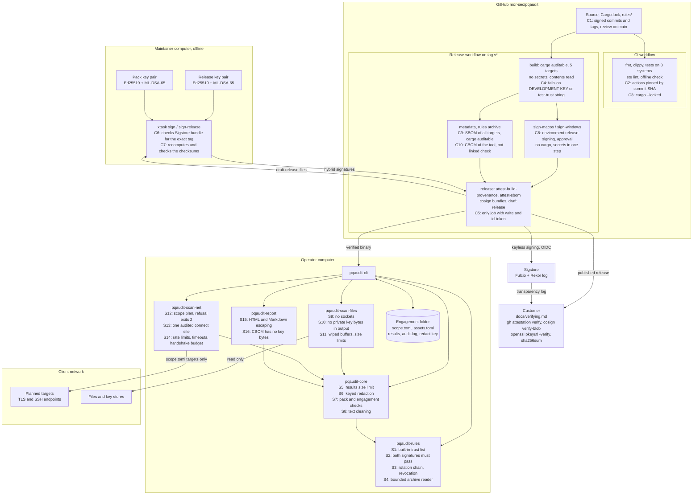

# pqaudit architecture

This document gives the architecture of pqaudit Stage 1. It lists the decisions from the design phase and the build. It shows the major components and how they keep the software and the supply chain safe. It uses ASD-STE100 Simplified Technical English.

The binding source is the design document, `docs/superpowers/specs/2026-10-20-pqaudit-design.md`. If this document and the design document do not agree, the design document is correct.

## 1. Purpose

pqaudit finds cryptography that a quantum computer can break. Security teams and consultants use it in client environments. It scans files and TLS and SSH endpoints. It adds the context of the client, gives each finding a score, and writes a technical report and a CycloneDX CBOM.

The tool goes into client networks. Thus the architecture has two more goals:

- **Safe operation.** The tool connects only to targets in the agreed scope, sends little traffic, and records each connection.
- **Trust.** A customer can check where each release came from and what it contains.

## 2. Components

### 2.1 Crates

| Crate | Function | Network |
|---|---|---|
| `pqaudit-cli` | Command line, engagement folder, exit codes, output. | Through `pqaudit-scan-net` only |
| `pqaudit-core` | Finding model, results file, fingerprints, merge, redaction, assessment, scoring, X.509 parser, text cleaning. | No |
| `pqaudit-rules` | Rules pack format, the default pack in the binary, signature checks, key rotation, pack installation. | No |
| `pqaudit-scan-files` | Offline scan of certificates, key stores, and SSH, PEM, DER, and GPG keys. | No sockets. CI checks this. |
| `pqaudit-scan-net` | Scope plan, rate limits, audit log, TLS and SSH probes. | Yes, to planned targets only |
| `pqaudit-report` | Technical report (HTML, Markdown, JSON) and CBOM. | No |
| `xtask` | Maintainer commands: STE text extraction, key generation, signing, rules archive, the CBOM of the tool, offline dependency check. | No |

`pqaudit-core` depends on `pqaudit-rules`. The scanners and the report depend on both. Only `pqaudit-cli` joins all crates. `pqaudit-scan-files` never depends on `pqaudit-scan-net`.

### 2.2 Data flow

1. `init` makes the engagement folder with five TOML files.
2. Each scan writes one `.pqr` results file. Its header names the rules pack and the scope and audit hashes.
3. `merge` joins results files. `--redact` changes names, paths, and addresses into keyed hashes.
4. `report`, `cbom`, and `explain` assess the results. They add context, deadlines, overrides, and scores.

## 3. Diagram

The diagram shows the components, the trust boundaries, and the security controls. Each control has the label **S** (software security) or **C** (supply chain security).

### 3.1 Software security controls

| ID | Control | Where |
|---|---|---|
| S1 | The trust list of pack keys is in the binary. A pack cannot add a trusted key. | `rules/trust/keys.toml`, `verify.rs` |
| S2 | A pack needs a correct Ed25519 signature and a correct ML-DSA-65 signature. | `verify.rs` |
| S3 | A rotation chain starts at a built-in key. A revoked key anywhere in the chain stops the pack. | `verify.rs` |
| S4 | The archive reader rejects unsafe paths, links, duplicates, and archives that are too large. | `archive.rs` |
| S5 | The tool reads at most 1 GiB from a results file, also after decompression. | `results.rs` |
| S6 | Redaction uses HMAC-SHA256 with a key for each engagement. The key file has mode 0600. | `merge.rs` |
| S7 | A report needs the same rules pack as the results. A report needs results from the same engagement. | `assess.rs`, `assessment.rs` |
| S8 | Text from peers and files loses control characters before output. | `text.rs` |
| S9 | The file scanner has no network crate. A CI job traces it with `strace`. | `check_offline.rs`, `ci.yml` |
| S10 | The tool never writes private key bytes to results, logs, reports, or errors. Leak tests check this. | `scan-files` tests |
| S11 | Key files go into buffers that the tool wipes. Each file has a size limit. | `file.rs` |
| S12 | The plan resolves each name one time. An address outside the scope refuses the full scan. | `scope.rs` |
| S13 | Only one function opens sockets. It writes a "started" line and a final line to the audit log. | `runtime.rs` |
| S14 | Limits apply to each IP address. A timeout covers each full attempt. | `runtime.rs`, `tls.rs` |
| S15 | The HTML template escapes all values. The Markdown writer escapes table and heading characters. | `technical.rs` |
| S16 | The CBOM lists keys by fingerprint and type only. | `cbom.rs` |

### 3.2 Supply chain controls

| ID | Control | Where |
|---|---|---|
| C1 | Changes go through a pull request and a review. Maintainers sign commits and tags. | `docs/maintaining.md` |
| C2 | Each third-party action has a full commit SHA. Each tool has an exact version. | `ci.yml`, `release.yml` |
| C3 | Each build uses `--locked` and the committed `Cargo.lock`. | `ci.yml`, `release.yml` |
| C4 | The release stops if the trust list holds the development key. It also stops if a binary holds the test trust override. | `release.yml` |
| C5 | Only the `release` job can write to the repository or get an OIDC token. It runs no cargo. | `release.yml` |
| C6 | `sign-release` checks each Sigstore bundle against the exact workflow identity of the tag. | `sign_release.rs` |
| C7 | `sign-release` computes the checksums. It refuses a checksum file that does not agree. | `sign_release.rs` |
| C8 | Signing secrets are only in the signing jobs. These jobs need approval and never build code. | `release.yml` |
| C9 | The SBOM covers all targets. `cargo auditable` puts the dependency list in each binary. | `release.yml` |
| C10 | The CBOM of the tool comes from a declaration. CI compares it with the SBOM and with `cargo tree`. | `self_cbom.rs`, `docs/self-crypto.toml` |

## 4. Architecture decisions

Each decision has an ID, the decision, the reason, and the consequence. The first group comes from the requester. The second group comes from the design. The third group comes from the build.

### 4.1 Decisions of the requester

| ID | Decision | Reason | Consequence |
|---|---|---|---|
| AD-01 | Users are security teams and consultants. | They do readiness assessments for clients. | The tool must be safe inside client networks. |
| AD-02 | One tool does the code, file, and network audits. | One engagement needs all three. | Stage 1 has the file and network audits. Stage 2 adds the code audit. |
| AD-03 | The outputs are a board report, a technical report, and a CBOM. | Boards and technical teams need different views. | Stage 1 has the technical report and the CBOM. Stage 3 adds the board report. |
| AD-04 | The language is Rust. | One static binary with no runtime. | Build targets for Linux, macOS, and Windows. |
| AD-05 | No host discovery. | Discovery can set off IDS alarms. | The scope file must list each target. |
| AD-06 | The report gives input to the risk assessment of the customer. | The customer owns the risk decision. | The tool suggests a priority and shows the formula. |
| AD-07 | The customer can override each priority. | The customer knows the context. | Overrides key on stable fingerprints. |
| AD-08 | Deadlines come from regional profiles. | Each country has different dates. | Profiles `us`, `uk`, and `au` in Stage 1. |
| AD-09 | The project is open source. | Customers can read the code that they run. | Public Sigstore transparency log entries. |
| AD-10 | The tool has its own SBOM and CBOM and has signatures. | Customers must trust the binary. | The release pipeline in section 3.2. |
| AD-11 | Releases come in three stages. | Each stage is useful by itself. | Stage 1 first: files, network, trust pipeline. |
| AD-12 | All text uses ASD-STE100. | Clear text for all readers. | A Vale lint in CI checks docs, help, messages, comments, and commits. |

### 4.2 Design decisions

| ID | Decision | Reason | Consequence |
|---|---|---|---|
| AD-13 | Scans and reports are separate steps. | Different persons and computers can do each step. | A portable `.pqr` results file with a JSON Schema. |
| AD-14 | The code audit matches API patterns. It does no data-flow analysis. | Fast and predictable. | The tool reports an algorithm that it cannot find as unresolved. |
| AD-15 | No record of quantum attack code. | No practical attack exists. A flag would mislead. | The customer sets the year of the first quantum computer. |
| AD-16 | The priority is a weighted sum of six factors. | Easy to explain and to override. | Weights in `scoring.toml`, checked when the engagement loads. |
| AD-17 | Missing context uses a cautious value and a visible flag. | The tool must not invent context. | Reports count the findings with unassessed context. |
| AD-18 | Complexity uses the sizes S, M, L, and XL. | A number would look more exact than it is. | Each size shows its reasons. |
| AD-19 | Rules packs have hybrid Ed25519 and ML-DSA-65 signatures. | A tool for PQC readiness must use PQC itself. | Two key pairs, held offline by the maintainers. |
| AD-20 | The binary contains the pack trust list. | A check without a network must not go out of date. | A new trust key needs a rotation statement or a new binary. |
| AD-21 | Deadline milestones have a kind and conditions. | A planning date is not a migration deadline. | Planning milestones show only for the engagement. |
| AD-22 | One finding for each rule and asset, each certificate, or each endpoint issue. | Readable reports for large estates. | Occurrences list each location. |
| AD-23 | Fingerprints do not use line numbers. | Overrides must survive small code changes. | A moved file gives an orphaned override. |
| AD-24 | The network defaults are gentle. | No IDS alarms, no load on production. | Higher values need `override_limits`. |
| AD-25 | The binary makes the PDF itself. | No browser or LaTeX on client computers. | Stage 3 work. |
| AD-26 | The licence is Apache-2.0 OR MIT. | Usual for Rust. | Both licence files ship. |

### 4.3 Decisions made during the build

| ID | Decision | Reason | Consequence |
|---|---|---|---|
| AD-27 | Rules files reject unknown fields and files in wrong places. | A typo must not widen a deadline. | A pack with a typo does not load. |
| AD-28 | The test trust override needs a debug build and a feature. The release checks the binaries. | The override must not reach a release. | Signed-pack CLI tests run only in debug builds. |
| AD-29 | The results inventory holds only items that are not findings. | Design section 11. | The CBOM joins findings and inventory. |
| AD-30 | Hand-written readers for SSH, PEM, DER, PKCS#8, and OpenPGP keys. | The library parsers copy private material into memory. | More parser code, with fuzz-style tests. |
| AD-31 | Public keys come from private seeds in memory when needed. | A private key and its public key must give one finding. | Expanded ML-DSA keys use a place fingerprint. |
| AD-32 | An address range check covers every resolved address before exclusions. | Design section 8.1. | One bad address refuses the full scan. |
| AD-33 | IPv4-mapped IPv6 ranges become IPv4 ranges. | A mapped exclusion must match. | A wide range that holds mapped space is an error. |
| AD-34 | At most 3 TLS handshakes for each IP address and port. | Several host names can share one address. | Extra host names get a scan error. |
| AD-35 | With a budget of 1, the probe uses the hybrid handshake. | PQC support is the main check. | No certificate chain if the hybrid handshake fails. |
| AD-36 | Ctrl-C keeps finished results and lists the rest. | Exit 3 means partial results. | The audit log is complete. |
| AD-37 | Redaction uses HMAC with an engagement key. IP addresses map into test ranges. | Plain hashes of host names are easy to guess. | Keep `redact.key` private. |
| AD-38 | Fingerprints stay the same after redaction. | Design section 10.1. Overrides depend on them. | Fingerprints of IP endpoints can show the IPv4 address. The documents say so. |
| AD-39 | Finding IDs come from fingerprints. | `explain` must show the same finding after a new merge. | IDs are not in sequence. |
| AD-40 | A report refuses a different rules pack, a duplicate override, or results from another engagement. | The report must not mix sources. | Keep the pack that made the results. |
| AD-41 | A multi-asset finding takes the first matching asset in `assets.toml`. | Occurrence order follows random run IDs. | The order of assets in the file matters. |
| AD-42 | The CBOM leaves out a security level that is not known. | A wrong level misleads. | Some algorithms have no level field. |
| AD-43 | The CBOM of the tool and the CBOM of an engagement are reproducible. | Design section 15. | No clock or random number in the output. |
| AD-44 | The SBOM is CycloneDX 1.5. | `cargo-cyclonedx` supports 1.5 at most. | The SBOM and the CBOM use different versions. |
| AD-45 | Signing jobs run apart from build jobs. | Build scripts must not read signing secrets. | The `release-signing` environment needs approval. |
| AD-46 | `sign-release` needs the exact tag. | An old signed binary must not pass as the new one. | The maintainer gives `--tag` for each release. |

## 5. Known limits

- The tool does not match the NAT64 or 6to4 form of an excluded IPv4 address.
- The code sets the hybrid TLS groups: `X25519MLKEM768` and `SecP256r1MLKEM768`. A rules pack cannot add groups.
- The PKCS#12 library keeps decrypted keys in memory that the tool cannot wipe. The tool drops them at once.
- The file scan does not read `.kbx` key boxes or JCEKS private-key entries.
- The tool does not read RSA public exponents of more than 4 bytes.
- Only a real CI run can confirm the cross-builds, the platform signing, and the attestation steps.

## 6. Open decisions

- Keyed fingerprints for IP endpoints in redacted results. This change hides the addresses, but old overrides must get new keys.
- STARTTLS, the code audit, the board report, PDF output, and more deadline profiles come in later stages.
